# How to put Human Wonder on your iPhone

*A step-by-step guide for testers. You need a Mac, your iPhone and its cable. It is free and takes about 30 minutes the first time. After that, new versions take 2 minutes and no cable.*

## What you are about to do, in plain words

Human Wonder is not in the App Store yet, so we send it to you as a file called **HumanWonder-iPhone.ipa**. An iPhone only runs such a file once it has been "signed" with an Apple ID, so you will sign it with **your own Apple ID**, free of charge, using three small helper apps:

| Helper | Where it goes | What it does |
|---|---|---|
| **LocalDevVPN** | iPhone (App Store) | A switch SideStore needs to install apps. It does not touch your internet traffic. |
| **iloader** | Mac (used once) | Puts SideStore on your iPhone through the cable. |
| **SideStore** | iPhone | Installs Human Wonder from the file, and keeps it working week after week. |

The pictures in this guide are simplified drawings. Your screens may look a little different, but the buttons have the same names.

## Before you start: check you have these

- ☐ An iPhone on **iOS 17 or newer** (Settings → General → About → iOS Version), with **2 GB free**.
- ☐ A **Mac** and the iPhone's **charging cable**.
- ☐ Your **Apple ID** email and password. Keep your other Apple device or phone nearby for the 6-digit code.
- ☐ **Wi-Fi** on both the Mac and the iPhone.
- ☐ The file **HumanWonder-iPhone.ipa** (about 400 MB), from the person who sent you this guide.

---

## Part 1 · On the iPhone (2 minutes)

### Step 1 · Install LocalDevVPN and switch it on

- Open the **App Store**, search for **LocalDevVPN**, tap **Get**.
- Open LocalDevVPN and tap **Connect**.
- iPhone asks to add a VPN configuration: tap **Allow**, then type your iPhone passcode.

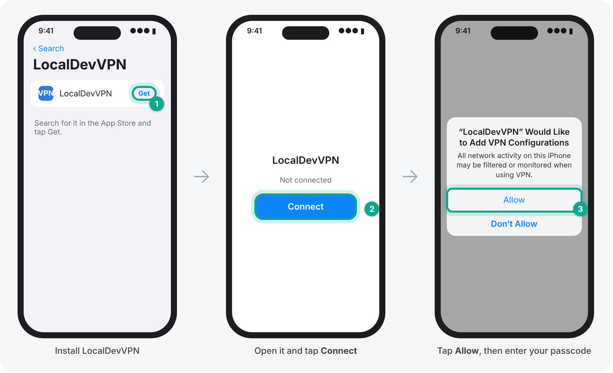

✅ **It worked when** LocalDevVPN says **Connected**.

---

## Part 2 · On the Mac (10 minutes, with the cable)

### Step 2 · Download iloader

- On the Mac, open Safari and go to **github.com/nab138/iloader/releases**
- Under the newest version, find **Assets** and click the file whose name ends in **darwin-universal.dmg**. It goes into your **Downloads** folder.

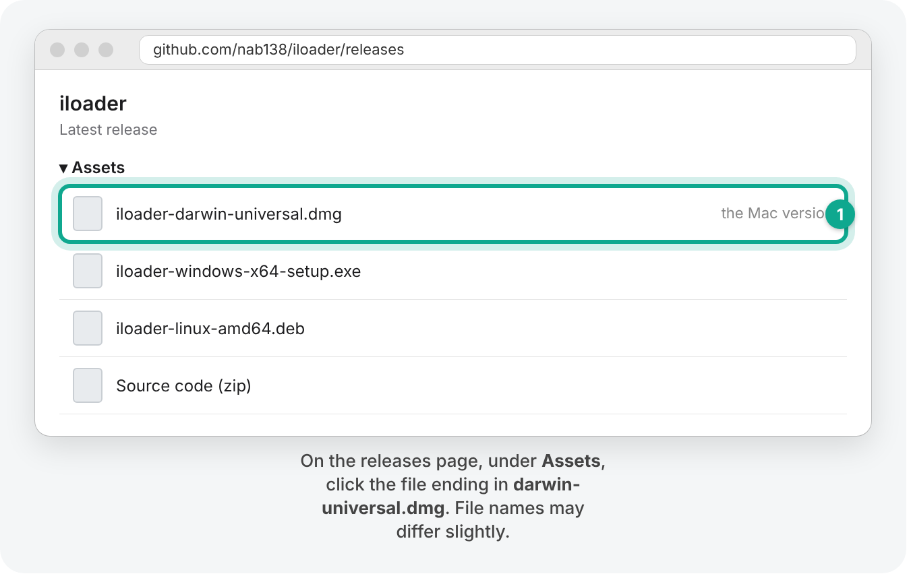

### Step 3 · Install iloader and open it

- Open **Downloads** and double-click the file you just downloaded. A window opens.
- Drag the **iloader** icon onto the **Applications** folder.
- Open **iloader** from your Applications folder (or press ⌘ Space, type *iloader*, press Return).
- If the Mac says iloader "can't be opened" or "was blocked": open **System Settings → Privacy & Security**, scroll down and click **Open Anyway**, then confirm.

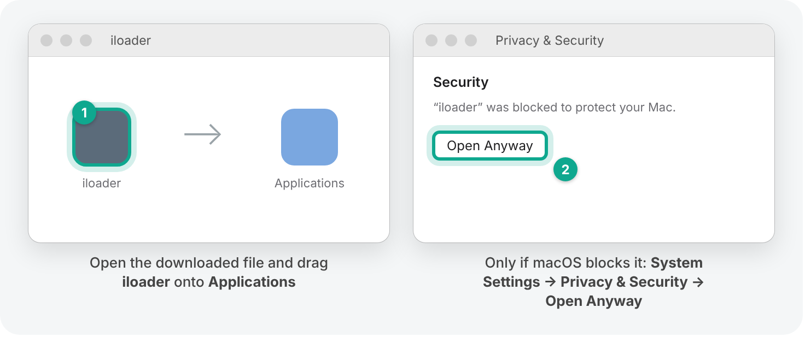

### Step 4 · Connect the iPhone with the cable

- Plug the iPhone into the Mac and **unlock** the iPhone.
- If the iPhone asks **Trust This Computer?**, tap **Trust** and type your passcode.

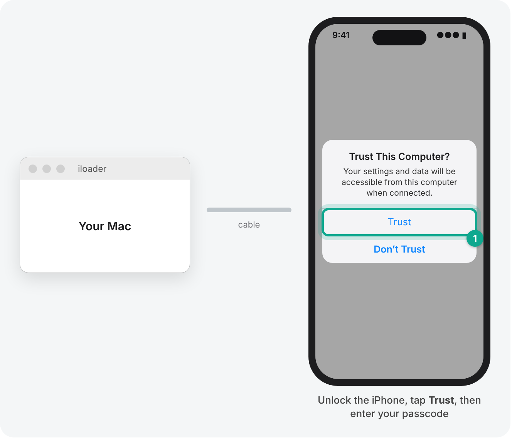

### Step 5 · Sign in and install SideStore

- In iloader, sign in with **your Apple ID** email and password, then type the 6-digit code Apple sends to your other device.
- Pick your iPhone and click **Install SideStore (Stable)**.
- Wait until iloader says it is **done** (a few minutes). **Keep the cable plugged in until then.**

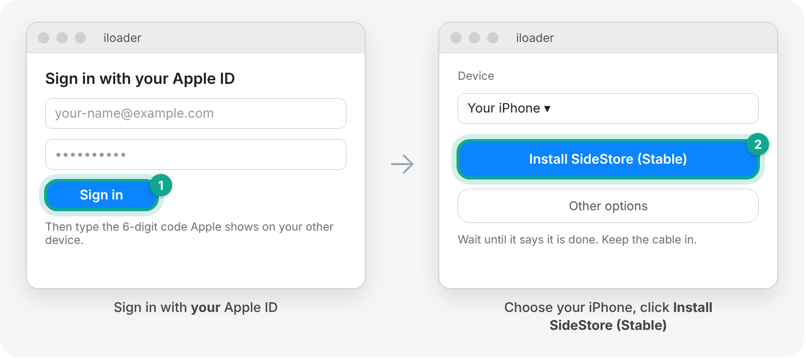

✅ **It worked when** a **SideStore** icon appears on your iPhone's Home Screen. It will not open yet; that is normal and Part 3 fixes it.

---

## Part 3 · On the iPhone: let SideStore run (5 minutes)

### Step 6 · Trust your Apple ID as a "developer"

The iPhone needs internet for this step.

- Open **Settings → General → VPN & Device Management**.
- Under **Developer App**, tap the line with your Apple ID email.
- Tap **Trust "Apple Development: …"**, then tap **Trust** again.

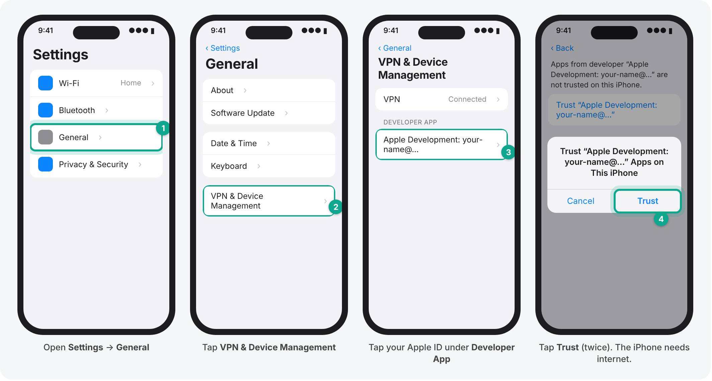

### Step 7 · Turn on Developer Mode

- Open **Settings → Privacy & Security**, scroll to the **very bottom**, tap **Developer Mode**.
- Switch it on and tap **Restart**. The iPhone restarts.
- After it restarts, unlock it: a message asks **Turn On Developer Mode?** Tap **Turn On** and type your passcode.

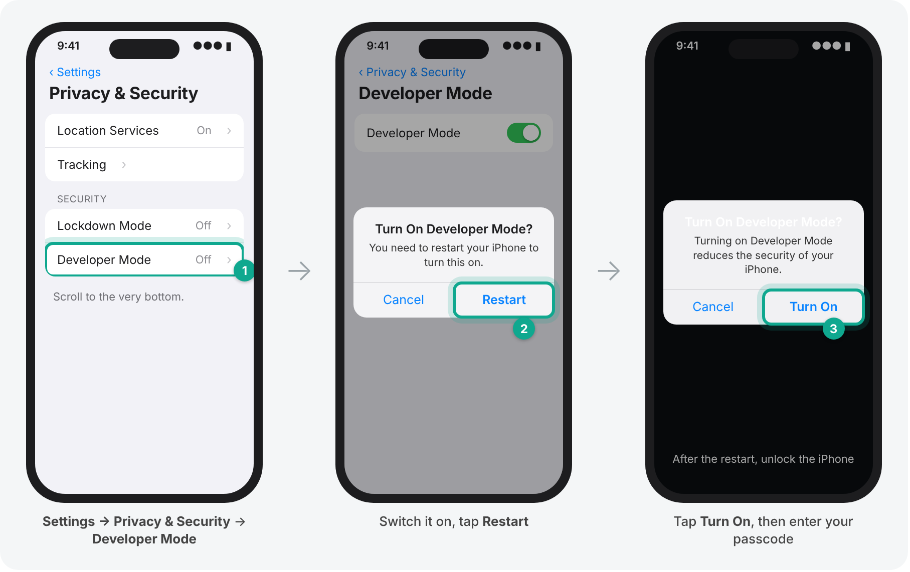

### Step 8 · Set up SideStore

- Open **LocalDevVPN** and make sure it says **Connected** (tap **Connect** if not).
- Open **SideStore**. When it asks to find devices on your local network, tap **Allow**. Allow notifications too.
- Go to the **Settings** tab inside SideStore and **sign in with the same Apple ID** you used in iloader.
- Go to the **My Apps** tab and tap the **7 DAYS** button next to SideStore. Wait a moment.

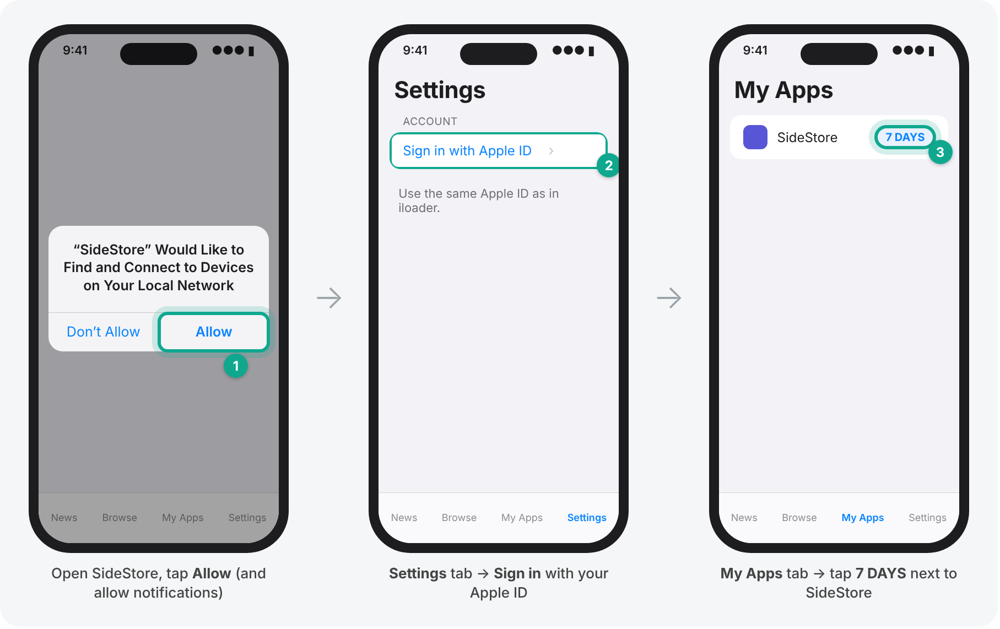

✅ **It worked when** the button next to SideStore still says **7 DAYS** after a moment and no error appears. **You can unplug the cable now.** You won't need the Mac again for normal use.

---

## Part 4 · Install Human Wonder (5 minutes, no cable)

### Step 9 · Put the file on the iPhone

Use whichever is easier:

- **From the Mac with AirDrop:** right-click **HumanWonder-iPhone.ipa** → **Share** → **AirDrop** → your iPhone. On the iPhone, choose **Open with SideStore** if it offers it, otherwise **Save to Files**.
- **From a link we sent you:** open the link on the iPhone and save the file to **Files**.

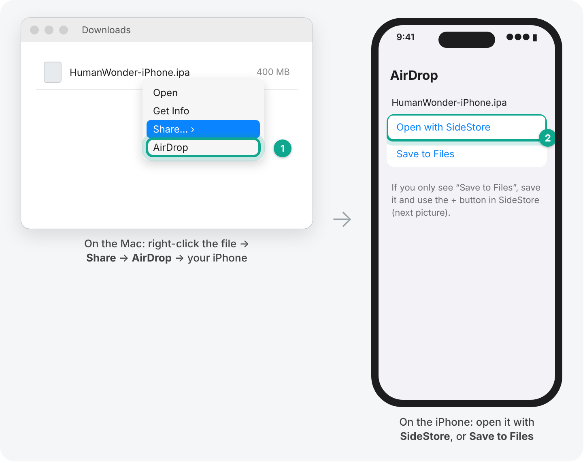

### Step 10 · Install it with SideStore

- Check that **LocalDevVPN** says **Connected**.
- Open **SideStore** → **My Apps** → tap **+** at the top left.
- Choose **HumanWonder-iPhone.ipa** (look in **Downloads** in the Files window).
- Wait while it installs. The file is large, so this takes a few minutes. **Keep SideStore open until it finishes.**
- Open **Human Wonder** from your Home Screen.

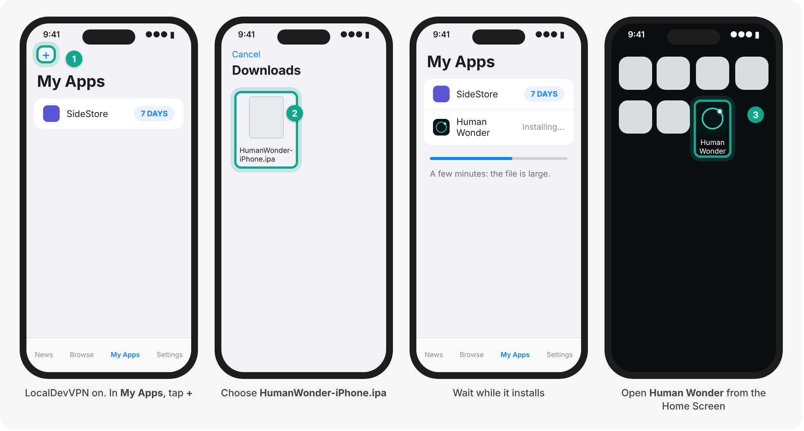

✅ **It worked when** Human Wonder opens and greets you. The first start can take a little longer while it gets ready. After that, it works **without internet**.

---

## Keeping it working (once a week, 30 seconds)

Apps signed with a free Apple ID last **7 days**. SideStore renews them by itself in the background when LocalDevVPN is connected and the iPhone is on Wi-Fi. To be safe, once a week:

- Open **LocalDevVPN** → it should say **Connected**.
- Open **SideStore** → **My Apps** → tap **Refresh All**. The days go back to 7.

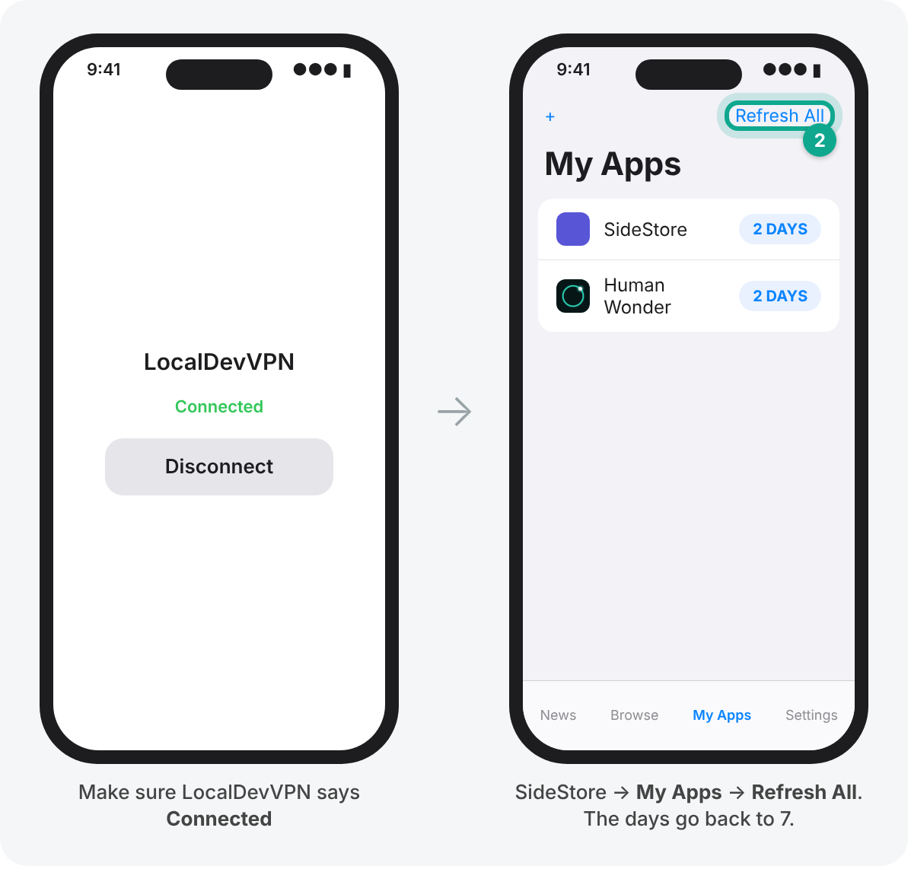

Good to know:

- **New versions:** when we send you a new `.ipa`, just do Part 4 again. It replaces the old version and keeps your conversations.
- **If SideStore itself ran out and won't open:** do Step 5 again on the Mac with the cable. Your apps and conversations stay.
- **Free Apple ID limits:** up to **3 apps** installed this way at the same time (SideStore counts as one), and up to **10 new app installs per week**.

## If something goes wrong

| What you see | What to do |
|---|---|
| iloader: "Failed to fetch URL Bag", or another network error when signing in | Turn off any VPN or firewall app on the Mac, or connect the Mac to a different network (your phone's hotspot works), then sign in again. |
| iloader doesn't show your iPhone | Unlock the iPhone, tap **Trust**, try another cable or USB port. |
| iPhone: "Untrusted Developer" | Do **Step 6**. |
| iPhone: "Developer Mode required" | Do **Step 7**. |
| SideStore can't install or refresh | Open LocalDevVPN and tap **Connect**, check you're on Wi-Fi, try again. |
| SideStore: "Maximum number of App IDs" | You've reached the free weekly limit. Wait a few days, or delete an app you installed with SideStore more than 7 days ago. |
| Human Wonder opened before but now closes straight away | It ran out: connect LocalDevVPN and tap **Refresh All** in SideStore. |
| Still stuck | Take a screenshot (side button + volume up) and send it to the person who sent you this guide. |

## About your Apple ID

iloader and SideStore use your Apple ID only to ask Apple to sign apps for **your own** iPhone. Everyone uses their own Apple ID. Human Wonder itself never asks for an account and works offline.
