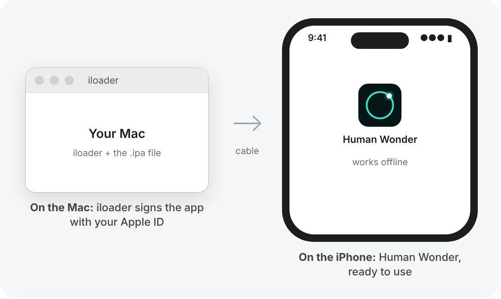
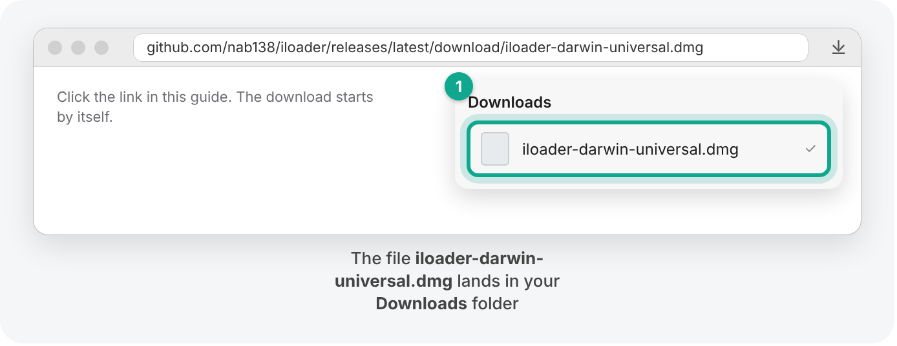
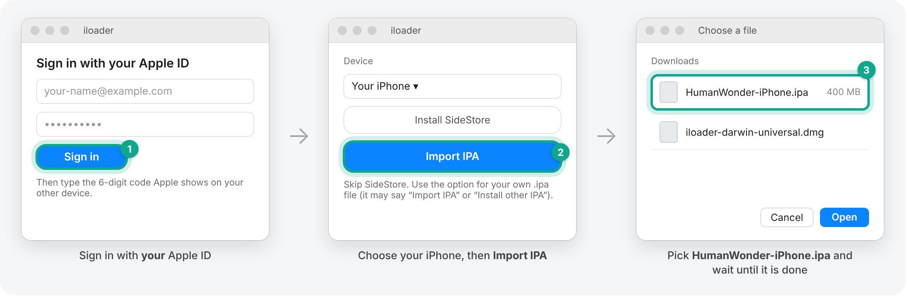
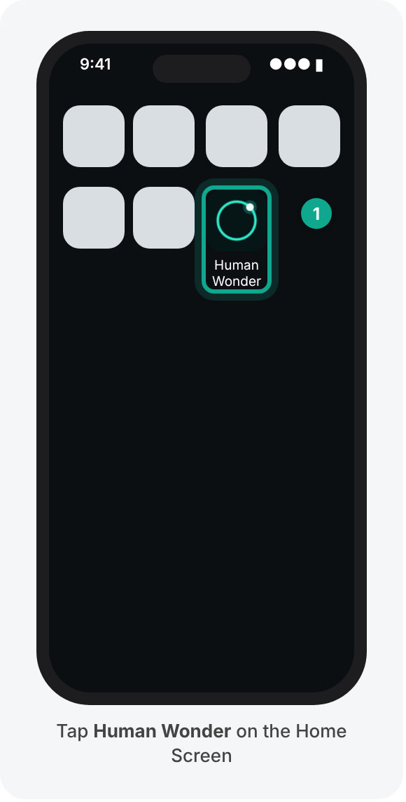

# How to put Human Wonder on your iPhone

*A step-by-step guide for testers of the Human Wonder iPhone app. You need a Mac, your iPhone and its cable. About 20 minutes the first time.*

## What you are about to do, in plain words

Human Wonder is in testing and not in the App Store yet. You receive the test build as a file, **HumanWonder-iPhone.ipa**, and install it on your iPhone from your Mac. This is a common way to test an iOS app on a real device before release.

Apple requires every app to be signed before an iPhone will run it. For a test build installed this way, the signature comes from **your own Apple ID**, so the app is registered to you and your device. **iloader**, an open-source Mac app, does the signing for you and installs the app through the cable. Nothing else is needed on the iPhone.

The pictures in this guide are simplified drawings. Your screens may look a little different, but the buttons have the same names.

## Before you start: check you have these

- ☐ An iPhone on **iOS 17 or newer** (Settings → General → About → iOS Version), with **2 GB of storage available**.
- ☐ A **Mac** and the iPhone's **charging cable**.
- ☐ Your **Apple ID** email and password. Keep your other Apple device or phone nearby for the 6-digit code.
- ☐ The file **HumanWonder-iPhone.ipa** (about 400 MB) saved on the Mac, for example in **Downloads**.

---

## Part 1 · Get iloader on the Mac (5 minutes)

### Step 1 · Download iloader

- On the Mac, click this link to download iloader for Mac:

  **[Download iloader for Mac](https://github.com/nab138/iloader/releases/latest/download/iloader-darwin-universal.dmg)**

  (github.com/nab138/iloader/releases/latest/download/iloader-darwin-universal.dmg)

- The file **iloader-darwin-universal.dmg** lands in your **Downloads** folder. The link always gives the newest version. iloader's official home is github.com/nab138/iloader.

### Step 2 · Install iloader and open it

- Open **Downloads** and double-click the file you just downloaded. A window opens.
- Drag the **iloader** icon onto the **Applications** folder.
- Open **iloader** from your Applications folder (or press ⌘ Space, type *iloader*, press Return).
- If the Mac says iloader "can't be opened" or "was blocked": open **System Settings → Privacy & Security**, scroll down and click **Open Anyway**, then confirm.

---

## Part 2 · Install Human Wonder (10 minutes, with the cable)

### Step 3 · Connect the iPhone with the cable

- Plug the iPhone into the Mac and **unlock** the iPhone.
- If the iPhone asks **Trust This Computer?**, tap **Trust** and type your passcode.

### Step 4 · Sign in to iloader and install the file

- In iloader, sign in with **your Apple ID** email and password, then type the 6-digit code Apple sends to your other device.
- Pick your iPhone. **Skip "Install SideStore"**: choose the option for your own file instead (it may be called **Import IPA** or **Install other IPA**).
- Choose **HumanWonder-iPhone.ipa** and click **Open**.
- Wait until iloader says it is **done**. The file is large, so this takes a few minutes. **Keep the cable plugged in until then.**

✅ **It worked when** iloader says it is done and the **Human Wonder** icon appears on your iPhone. It won't open yet; that's normal, and Part 3 fixes it. You can unplug the cable now.

---

## Part 3 · On the iPhone: allow it to run (5 minutes, once)

### Step 5 · Trust your Apple ID as a "developer"

The iPhone needs internet for this step.

- Open **Settings → General → VPN & Device Management**.
- Under **Developer App**, tap the line with your Apple ID email.
- Tap **Trust "Apple Development: …"**, then tap **Trust** again.

### Step 6 · Turn on Developer Mode

- Open **Settings → Privacy & Security**, scroll to the **very bottom**, tap **Developer Mode**.
- Switch it on and tap **Restart**. The iPhone restarts.
- After it restarts, unlock it: a message asks **Turn On Developer Mode?** Tap **Turn On** and type your passcode.

### Step 7 · Open Human Wonder

- Tap **Human Wonder** on your Home Screen.

✅ **It worked when** Human Wonder opens and greets you. The first start can take a little longer while it gets ready. After that, it works **without internet**.

---

## Every 7 days: renew it (5 minutes, with the cable)

A test build signed with a personal Apple ID stays valid for **7 days**; this is Apple's rule for apps installed for testing. After that Human Wonder won't open until it is renewed. To renew it:

- Do **Step 3** and **Step 4** again with the same file. You don't need to repeat Part 1 or Part 3.
- Your **conversations stay**; only the 7 days start again.

Good to know:

- **New versions:** when we send you a new `.ipa`, do Step 3 and Step 4 with the new file. It replaces the old version and keeps your conversations.
- **Apple's limits for test installs on a personal Apple ID:** up to **3 apps** installed this way at the same time, and up to **10 new app installs per week**.

## If something goes wrong

| What you see | What to do |
|---|---|
| iloader: "Failed to fetch URL Bag", or another network error when signing in | Turn off any VPN or firewall app on the Mac, or connect the Mac to a different network (your phone's hotspot works), then sign in again. |
| iloader doesn't show your iPhone | Unlock the iPhone, tap **Trust**, try another cable or USB port. |
| iloader asks about Developer Mode | Do **Step 6** on the iPhone, then try again. |
| iPhone: "Untrusted Developer" | Do **Step 5**. |
| iPhone: "Developer Mode required" | Do **Step 6**. |
| iloader: "Maximum number of App IDs" | You've reached Apple's weekly limit for test installs. Wait a few days, or delete an app you installed this way more than 7 days ago. |
| Human Wonder opened before but now closes straight away | The 7 days are up: renew it (Step 3 and Step 4). |
| Still stuck | Take a screenshot (side button + volume up) and send it to the person who sent you this guide. |

## About your Apple ID

iloader uses your Apple ID only to ask Apple to sign the test build for **your own** iPhone; your password goes to Apple, not to us. Every tester uses their own Apple ID. Human Wonder itself never asks for an account and works offline.
